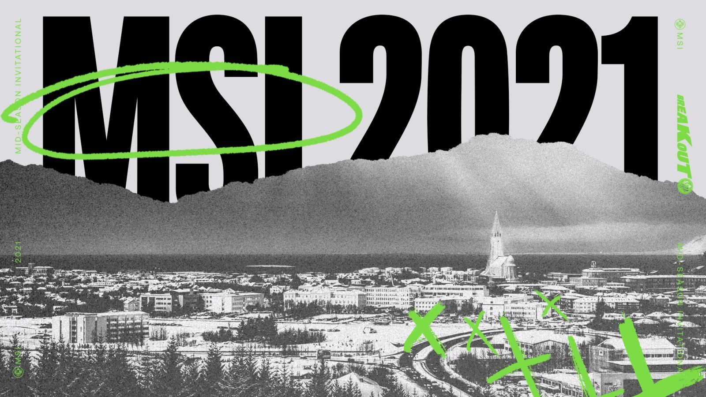
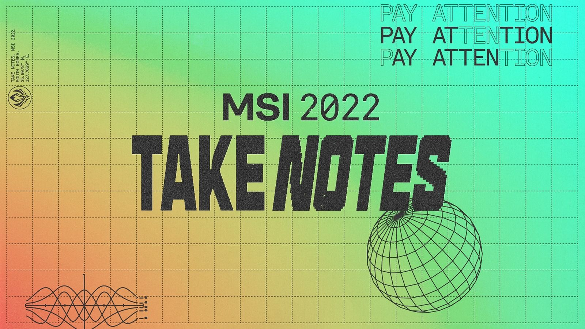
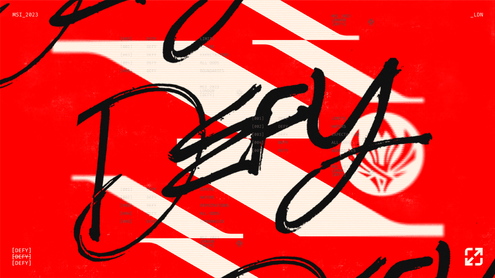
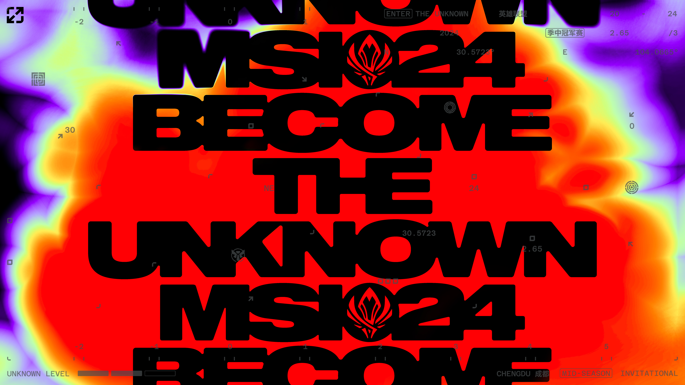
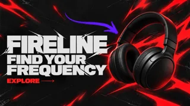
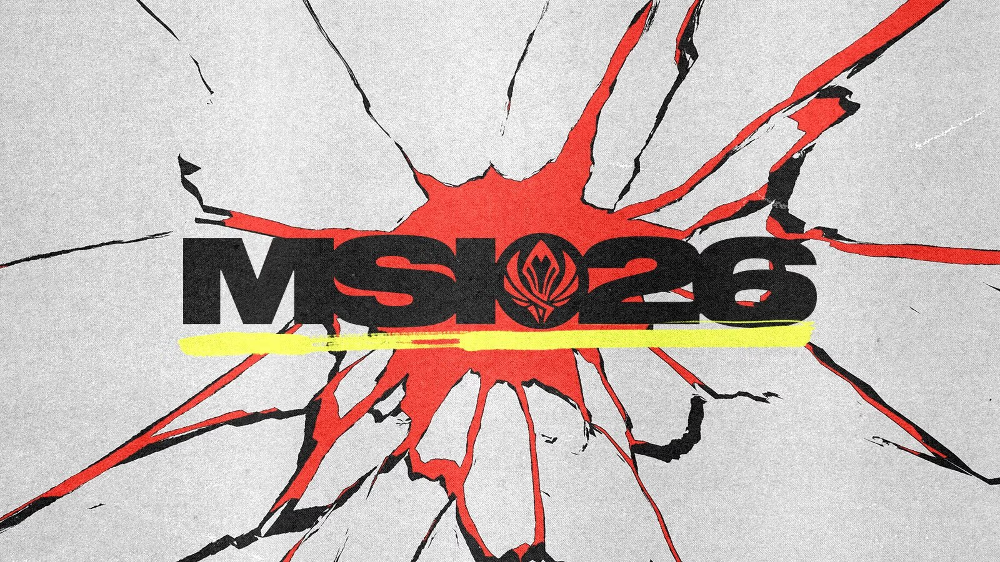
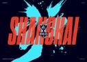

# Style Atlas Skills · 视觉风格工具库

将已提炼的视觉风格用于 AI 设计与绘图 Prompt。

Style Atlas 按视觉来源组织可复用的设计工具，持续收录赛事、品牌、电影等不同板块。英雄联盟国际赛事是其中一个板块，MSI 是其下的一个赛事系列；当前已收录六套 MSI 风格与 Worlds 2017。完整研究包与网站内容生产工作流保留本地。

[Style Atlas 展示网站](https://style-atlas-msi-2026.jiahuizz3.chatgpt.site/)

网站当前仍限制访问；本仓库内容可以独立使用，不要求访问网站。网站分享权限需另行配置。

<!-- style-catalogue:start -->
## 来源目录

- 赛事视觉
  - 英雄联盟国际赛事
    - MSI 季中冠军赛
    - Worlds 全球总决赛

分类只显示已收录内容。Worlds（S 赛）与 MSI 属于英雄联盟国际赛事下的并列系列；其他赛事、品牌和电影等来源可按实际收录继续登记。

## 选择需要的工具

### 赛事视觉 / 英雄联盟国际赛事 / MSI 季中冠军赛

| 主视觉 | Skill | 关键词 |
| --- | --- | --- |
|  | [msi-2021-visual-style](skills/msi-2021-visual-style/SKILL.md) | 窄高字体、荧光绿、撕边拼贴、手写注释 |
|  | [msi-2022-visual-style](skills/msi-2022-visual-style/SKILL.md) | 虚线方格、柔和渐变、像素阶梯、线框几何、紧缩变形字体 |
|  | [msi-2023-visual-style](skills/msi-2023-visual-style/SKILL.md) | 签名字叠层、截断斜带、红米白黑、扫描拖影、极窄大字 |
|  | [msi-2024-visual-style](skills/msi-2024-visual-style/SKILL.md) | 光谱异常体、宽重字体、黑红识别、数据纹理 |
|  | [msi-2025-visual-style](skills/msi-2025-visual-style/SKILL.md) | 电性锋芒、宽重紧排、紫色手势、体育编排 |
|  | [msi-2026-visual-style](skills/msi-2026-visual-style/SKILL.md) | 宽重字体、手绘标记、规则信息、纸感纹理 |

### 赛事视觉 / 英雄联盟国际赛事 / Worlds 全球总决赛

| 主视觉 | Skill | 关键词 |
| --- | --- | --- |
|  | [worlds-2017-visual-style](skills/worlds-2017-visual-style/SKILL.md) | 光滑浅纹、蓝灰阴影、釉状光泽、金边、中国书法、非动物迁移 |
|  | [worlds-2019-visual-style](skills/worlds-2019-visual-style/SKILL.md) | 象牙白雕塑、浮岛、纪念碑空间、局部金属、浅色空间、冷蓝紫背光 |
|  | [worlds-2021-visual-style](skills/worlds-2021-visual-style/SKILL.md) | 灰白浮雕、中心圆章、多层起伏、硬边倒角、有机曲面、浅刻纹理、接触阴影、蓝晶面、实体字 |
|  | [worlds-2020-visual-style](skills/worlds-2020-visual-style/SKILL.md) | 青色笔势、橙红窄高字、深蓝、书法、尖角线图、上海、传统暗纹、云气轮廓、层叠弧线、图像填字、字形遮罩、暖金窄字 |

## 下载

| 来源分类 | 风格 | 独立下载 |
| --- | --- | --- |
| 赛事视觉 / 英雄联盟国际赛事 / MSI 季中冠军赛 | MSI 2021 | [下载完整 Skill ZIP](https://github.com/jiahuiyang511-dotcom/style-atlas-skills/releases/download/v1.1.2/msi-2021-visual-style.zip) |
| 赛事视觉 / 英雄联盟国际赛事 / MSI 季中冠军赛 | MSI 2022 | [下载完整 Skill ZIP](https://github.com/jiahuiyang511-dotcom/style-atlas-skills/releases/download/v1.1.2/msi-2022-visual-style.zip) |
| 赛事视觉 / 英雄联盟国际赛事 / MSI 季中冠军赛 | MSI 2023 | [下载完整 Skill ZIP](https://github.com/jiahuiyang511-dotcom/style-atlas-skills/releases/download/v1.1.2/msi-2023-visual-style.zip) |
| 赛事视觉 / 英雄联盟国际赛事 / MSI 季中冠军赛 | MSI 2024 | [下载完整 Skill ZIP](https://github.com/jiahuiyang511-dotcom/style-atlas-skills/releases/download/v1.1.2/msi-2024-visual-style.zip) |
| 赛事视觉 / 英雄联盟国际赛事 / MSI 季中冠军赛 | MSI 2025 | [下载完整 Skill ZIP](https://github.com/jiahuiyang511-dotcom/style-atlas-skills/releases/download/v1.1.2/msi-2025-visual-style.zip) |
| 赛事视觉 / 英雄联盟国际赛事 / MSI 季中冠军赛 | MSI 2026 | [下载完整 Skill ZIP](https://github.com/jiahuiyang511-dotcom/style-atlas-skills/releases/download/v1.1.2/msi-2026-visual-style.zip) |
| 赛事视觉 / 英雄联盟国际赛事 / Worlds 全球总决赛 | Worlds 2017 | [下载完整 Skill ZIP](https://github.com/jiahuiyang511-dotcom/style-atlas-skills/releases/download/worlds-2017-v1.0.0/worlds-2017-visual-style.zip) |
| 赛事视觉 / 英雄联盟国际赛事 / Worlds 全球总决赛 | Worlds 2019 | [下载完整 Skill ZIP](https://github.com/jiahuiyang511-dotcom/style-atlas-skills/releases/download/worlds-2019-v1.0.0/worlds-2019-visual-style.zip) |
| 赛事视觉 / 英雄联盟国际赛事 / Worlds 全球总决赛 | Worlds 2021 | [下载完整 Skill ZIP](https://github.com/jiahuiyang511-dotcom/style-atlas-skills/releases/download/worlds-2021-v1.0.0/worlds-2021-visual-style.zip) |
| 赛事视觉 / 英雄联盟国际赛事 / Worlds 全球总决赛 | Worlds 2020 | 待发布 |

[全部发布版本](https://github.com/jiahuiyang511-dotcom/style-atlas-skills/releases) · 各版本附 SHA256SUMS.txt。历史链接保留，每种风格可独立更新版本。

<!-- style-catalogue:end -->

## 使用

从本项目 Releases 下载对应 Skill ZIP，解压并保留整个 Skill 目录，包含 SKILL.md、references、assets 和已有 scripts。按所用智能体工具的 Skill 安装方式导入；不要只复制入口文件，否则可能缺少规则、模板和参考图。

例如：

> 使用 msi-2023-visual-style，为原创夜跑品牌设计一张 3:4 活动海报。标题为“夜行计划”，保留时间地点区。先建立信息层级和构图，再制作，并核对文字与风格关系。

只有文字能力时可交付设计方案；制作实际图片需要当前工具具备图像生成或设计能力。Skill 本身不包含模型或图像服务。这些风格 Skill 的使用不要求连接作者的网站。

## 更新与下载

源文件按 Skill 分目录维护；正式 ZIP 放 Releases 附件，不反复提交压缩包。下载时优先选定明确版本。网站可链接到对应版本的附件。后续新增风格沿用相同目录结构，并更新打包脚本中的风格清单。发布新 Release 时，GitHub Actions 会自动生成独立 ZIP 和校验文件；也可以在 Actions 中手动重新打包最近一次发布。

## 来源与边界

这些是独立研究与设计转译工具，并非赛事或品牌的官方 Skill。原图、商标及其他第三方素材仍归相应权利人；出处保留在各 Skill 的 references 中。具体字体、色号和动态行为的已验证范围以各 Skill 为准。参考图用于研究依据，制作时使用用户品牌和原创内容。

本次整理没有为原内容新增开源许可证，使用与再分发范围请参阅 [来源说明](SOURCE_NOTICE.md)。

## 维护与扩展

来源结构见 [LIBRARY_STRUCTURE.md](LIBRARY_STRUCTURE.md)，机器可读索引见 [catalog.json](catalog.json)。新增风格时登记分类、届次、Skill 路径、原作缩略图及实际下载链接，运行 `python scripts/sync_catalogue.py` 更新本页；打包器直接读取目录索引，无需改写赛事年份清单。已有 Skill 目录、详情网址和历史版本下载链接保留。
