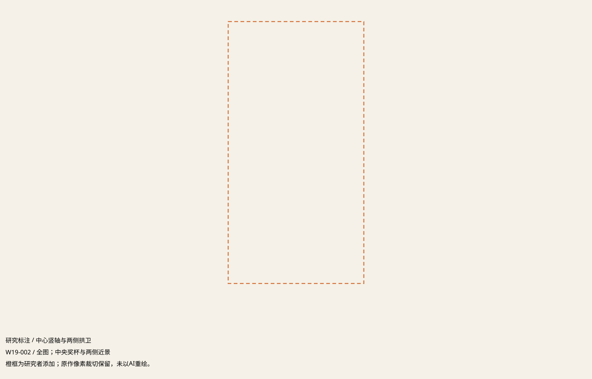
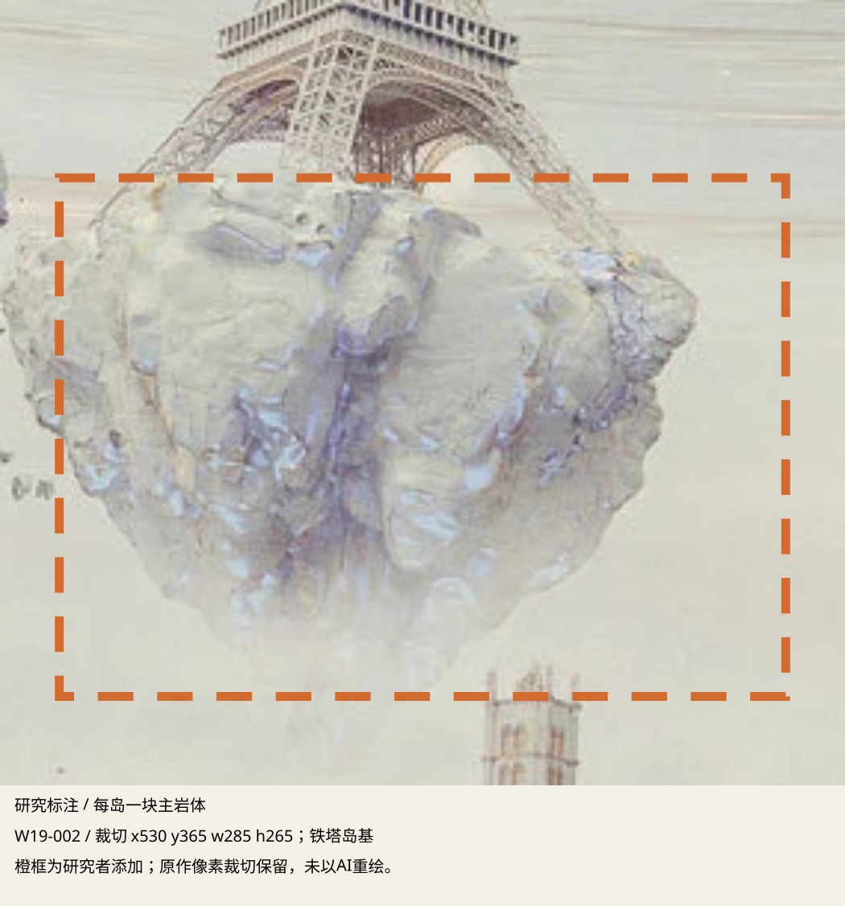
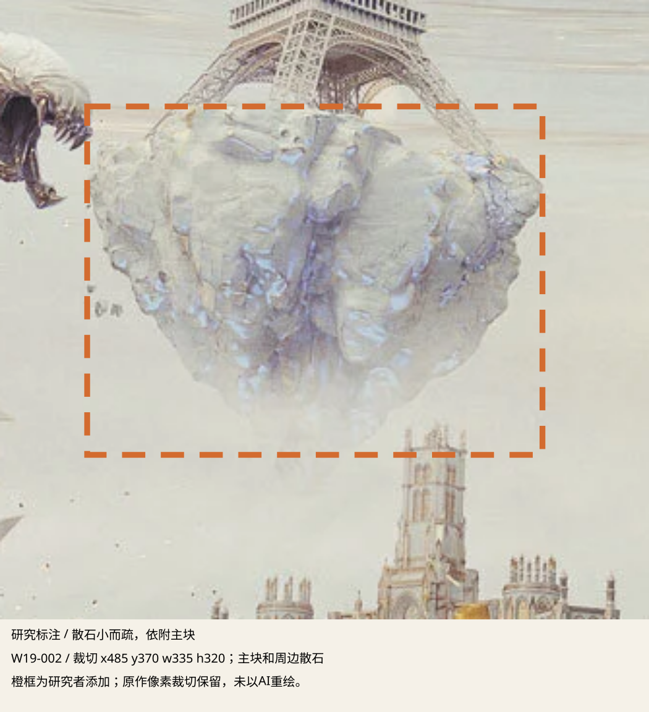
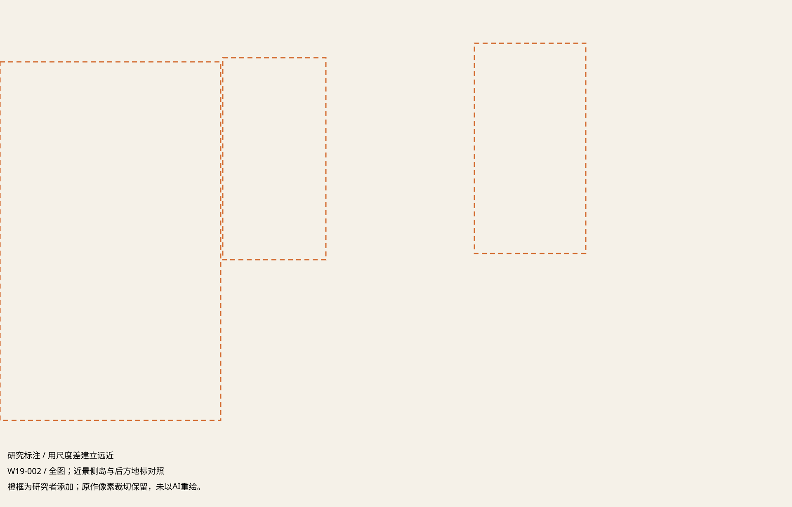
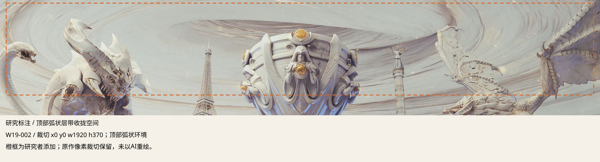
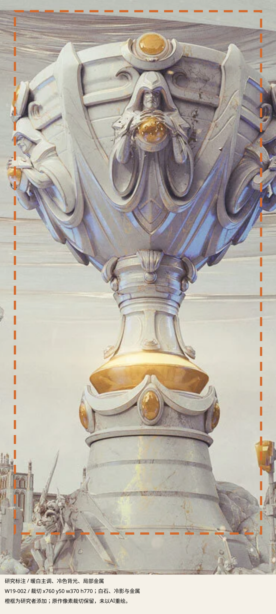
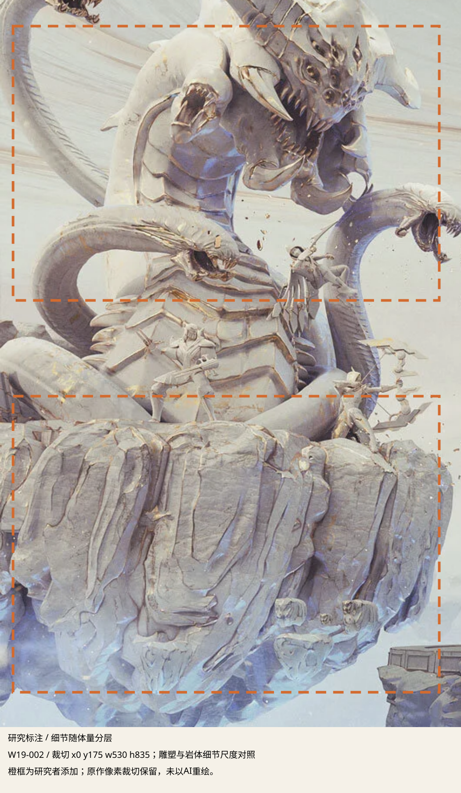

# 封面主视觉：重新分析的7点

基于已核实的 LostProject Worlds 2019 原作 W19-002，文件 sources/lp-01.jpg，1920×1080。这里的“封面”指风格条目采用的创作方原作主视觉，不以AI生成的刊物封面作为证据。下列观察与转译分开；它们是研究归纳，不是官方标准。

本轮更正：上一版把岩基的大切面、层理误推成了密集碎石，生成图因此过碎。现在以一座岛下方一块占主导的连贯主岩体，加少量隔空散石为主规则；表面裂缝仍可存在，但不能把体块割成平均小块。
## 1. 中心竖轴与两侧拱卫

观察：奖杯占据中央竖向识别轴，左右大型角色与浮岛形成拱卫，前后错位而非机械镜像。转译：先建立一个主视觉体量，再用从属体块围合；迁移时可偏心，但不要让主岩体、辅岛和装饰同时争夺焦点。

证据：W19-002 / 全图；中央奖杯与两侧近景。

## 2. 每岛一块主岩体

观察：埃菲尔铁塔、右侧纪念柱与前景岛下方，各有一块连贯、占主导的岩体。表面的裂缝和层理依附于这块整体。转译：先做一块有重量的悬岩，再处理大切面；禁止用许多同尺寸石块拼出岛底。

证据：W19-002 / 裁切 x530 y365 w285 h265；铁塔岛基。

## 3. 散石小而疏，依附主块

观察：小碎块位于主岩体外缘及下方，与主岩有空气间隙，体积远小于主块；远处带建筑的辅岛是另一层。转译：主块先读、散石后读，保留间隙，别把空间塞成碎片云。

证据：W19-002 / 裁切 x485 y370 w335 h320；主块和周边散石。

## 4. 用尺度差建立远近

观察：左右近景角色与岛体较大，中央后方地标明显缩小；遮挡、反差递减和虚化补充远近。转译：用少量清晰尺度级组织空间，远处岛体简化，不把所有岛做成同等大小、同等锐利。

证据：W19-002 / 全图；近景侧岛与后方地标对照。

## 5. 顶部弧状层带收拢空间

观察：画面上方有跨越左右的弧状石质层带，曲线围绕中央空间延展。它属于环境结构，不是满屏松散云絮。转译：用大尺度弧线收拢主体，细节顺曲面走，避免再叠许多小装饰。

证据：W19-002 / 裁切 x0 y0 w1920 h370；顶部弧状环境。

## 6. 暖白主调、冷色背光、局部金属

观察：主体与环境以象牙白和灰白为主；岩体背光和底部是冷蓝紫，金属集中在奖杯及角色局部部件。转译：白色保留明暗转折，冷色覆盖受光面而非裂缝发光，金色只建立局部识别。

证据：W19-002 / 裁切 x760 y50 w370 h770；白石、冷影与金属。

## 7. 细节随体量分层

观察：角色和奖杯有相对完整的石雕面及受控接缝，建筑有更细的构件；岛体先读大面和层理。转译：不要给所有表面铺同样密的裂纹，缩图看体量、放大看材质；字体与信息网格在该原图中没有证据。

证据：W19-002 / 裁切 x0 y175 w530 h835；雕塑与岩体细节尺度对照。

字体名、品牌色号、网格数值和动态规则仍未核实，不从无文字的原作倒推官方排版规范。
